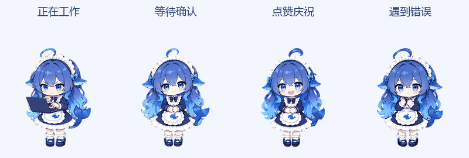

# GPT大肥鱼

Codex 自定义桌宠：蓝发鲸鱼娘“大肥鱼”。提供基础版与打工增强版、透明图集、对比预览及可复用制作工具。非官方、非商业同人项目。



打工增强版包含敲键盘工作、摊手等待确认、点赞完成、抱头报错四组新动作；其余动作与16方向视线沿用基础版。

- [下载打工增强版](downloads/dafeiyu-work.zip)
- [下载基础版](downloads/dafeiyu-starter.zip)
- [状态静态预览](previews/work-states.png)
- [拓展与制作说明](docs/authoring.md)
- [来源、署名与使用条件](NOTICE.md)

解压后将整个宠物目录复制到 Codex 数据目录的 pets/ 下（默认用户目录的 .codex/pets/）。在设置 → 宠物中刷新并选择“大肥鱼·打工增强版”，使用 `/pet` 显示。需要支持 v2 自定义宠物的 Codex；按26.1021.3705.0版协议制作，其他版本可能不同。

也可以使用工具安装：

```sh
python -m pip install -r requirements.txt
python tools/pet_tool.py validate pets/dafeiyu-work
python tools/pet_tool.py install pets/dafeiyu-work
```

工具使用 CODEX_HOME 或默认用户目录 .codex，可通过 --codex-home 指定其他数据目录；已有不同内容的同ID宠物不会被覆盖。

下载整个仓库后，直接在浏览器打开 preview.html，可切换两个版本、状态、背景、大小、速度与鼠标视线。GitHub文件页面本身不会执行该预览。

```sh
python tools/pet_tool.py preview pets/dafeiyu-work --compare pets/dafeiyu-starter --output preview.html
```

图集结构1536×2288，8列11行，单格192×208。qa/ 为公开导出验证结果；工具能复建增强图集，详细过程见制作说明。AI生成动作经人工视觉检查，仍可能有轻微风格差异。

角色与参考素材具有第三方权利，公开下载不代表完整商业授权，请先阅读 NOTICE.md。此仓库不包含账号配置、模型、DeepseekHermes程序或上游原始视频。
